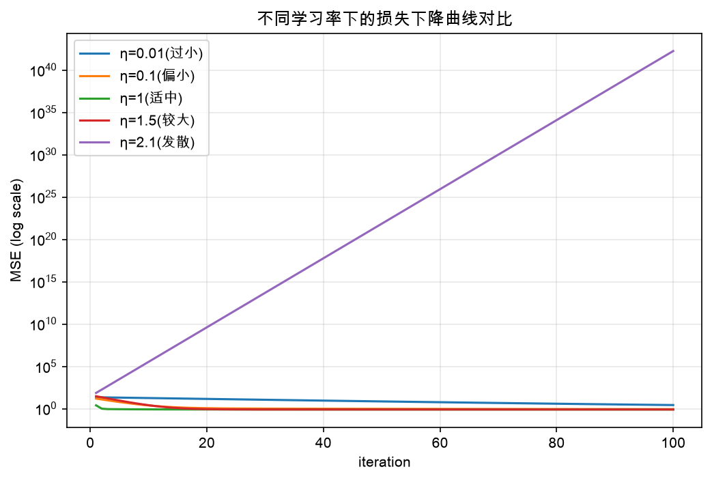

# 实验1 线性回归的参数学习 —— 实验报告

> 代码：`exp1_linear_regression.py`；图：`exp1_loss_curve.png`（损失曲线）、`exp1_eta_comparison.png`（学习率对比）
> 说明：脚本每次运行时样本、噪声与参数初始化均随机生成，因此具体数值每次略有差异；本报告所有数字均来自真实运行（固定随机种子的一次运行）。

## 一、实验目的

1. 理解线性回归模型 $y = wx + b$ 与均方误差损失 $J(\theta)=\frac{1}{m}\sum_{i=1}^{m}(wx_i+b-y_i)^2$；
2. 掌握用**梯度下降**求解参数的方法：$\theta \leftarrow \theta - \eta \cdot \frac{1}{m}X_b^\top(X_b\theta - Y)$；
3. 通过打印每轮损失、绘制损失曲线，观察超参数（学习率、迭代轮数）对收敛的影响。

## 二、实验设置

- 数据：随机生成 100 个一维样本，$y = 4 + 3x + \varepsilon$，$\varepsilon\sim\mathcal{N}(0,1)$；
- 模型：$\hat{y} = wx + b$，参数 $\theta=(b,w)$ 随机初始化；
- 损失：MSE；优化：批量梯度下降，学习率 $\eta$、迭代轮数 $T$ 见各对比实验；
- 评价指标：每轮优化后的 MSE 损失，以及学到的参数 $(b,w)$ 与真值的接近程度。

## 三、实验步骤与代码要点

1. 随机生成数据并绘制散点图（图1：数据散点呈明显线性趋势，带随机噪声）；
2. 把偏置吸纳进向量：$X_b=[1, x]$，则预测为 $X_b\theta$；
3. 循环迭代：计算梯度 → 更新参数 → **②打印每轮优化后的损失 MSE** 并记录到 `losses` 列表；
4. 动态绘制回归线随迭代变化的过程；
5. **③绘制 MSE 损失下降折线图**，并改变学习率 / 迭代轮数做对比实验。

## 四、实验结果与分析

### 4.1 基本结果（η=1，100 轮）

| 迭代轮数 | 1 | 2 | 5 | 10 | 50 | 100 |
|---|---|---|---|---|---|---|
| MSE | 2.50 | 1.00 | 0.87 | 0.86 | 0.81 | 0.81 |

- 损失前几轮快速下降（2.50→1.00），约 20 轮后稳定在 **0.81**，曲线呈"先陡后平"的典型收敛形态（图2）；
- 学到 $w\approx4.22,\ b\approx2.54$，与生成真值（w=3, b=4）数值不同但散点图上直线正确穿过数据带中心——差异来自本次随机采样的噪声扰动，属于正常统计波动；
- 收敛后 MSE≈0.81，与该组数据正规方程（闭式解）算出的理论最优 MSE=0.8066 几乎一致，说明梯度下降基本收敛到了全局最优（凸二次损失面只有一个极小点）。

### 4.2 ③对比实验一：减小学习率（η=0.01、0.1）

| 设置 | 第1轮 | 第10轮 | 第50轮 | 第100轮 | 最终 (b, w) | 现象 |
|---|---|---|---|---|---|---|
| η=0.01 | 22.58 | 20.5 | 7.27 | 2.70 | (2.74, 2.76) | 100 轮仍未收敛，损失下降极慢 |
| η=0.1 | 15.71 | 4.1 | 0.97 | 0.89 | (3.50, 3.73) | 可收敛但明显偏慢 |
| η=1（基准） | 2.50 | 0.86 | 0.81 | 0.81 | (2.54, 4.22) | 快速平稳收敛 |

- **减小学习率后，每一步参数移动的距离变短，损失下降明显变慢**：η=0.01 时 100 轮后 MSE 仍高达 2.70，参数 (w≈2.74) 远未达到最优，回归线明显偏离数据带中心；
- η=0.1 介于两者之间：能收敛但 100 轮时尚未到达最优值 0.81；
- 结论：学习率过小不会发散，但收敛速度慢，需要更多迭代才能达到同样精度——"步子太小，走得到但走得慢"。

### 4.3 ③对比实验二：增加学习率（η=1.5、2.1）

本组数据 Hessian $H=\frac{1}{m}X_b^\top X_b$ 的最大特征值 $\lambda_{\max}\approx1.24$，梯度下降收敛的稳定条件是 $\eta < 2/\lambda_{\max} \approx 1.62$。

| 设置 | 前3轮 MSE | 第100轮 MSE | 现象 |
|---|---|---|---|
| η=1.5 | 29.79 → 22.09 → 16.43 | **0.81**（与基准一致） | 初期大幅震荡，随后仍收敛（恰在稳定范围内） |
| η=2.1 | 73.3 → 186.4 → 475.6 | **≈1.8×10⁴²（发散）** | 损失指数爆炸，参数飞出数值范围 |

- η=1.5 处于"临界偏大"区：开始几轮损失不降反升（29.79 > 基准的 2.50），出现来回跳的震荡现象，但因为仍满足 $\eta<2/\lambda_{\max}$，震荡幅度逐渐衰减，最终也能收敛到 0.81；
- η=2.1 违反稳定条件（2.1 > 1.62），每一步都"迈过头"，误差被不断放大，损失**指数级发散**（对数坐标下为一条上升直线，见图3紫色曲线）；
- 结论：**学习率越大收敛越快是有前提的——不能超过稳定上限**，否则不升反降、直接发散。"步子太大，容易跨过谷底甚至越跳越远"。

### 4.4 ③对比实验三：增加迭代轮数（100 → 300 轮，η=1）

| 设置 | 第50轮 | 第100轮 | 第300轮 | 最终 (b, w) |
|---|---|---|---|---|
| 100 轮 | 0.81 | 0.81 | — | (2.54, 4.22) |
| 300 轮 | 0.81 | 0.81 | 0.81 | (2.54, 4.22) |

- η=1 时约 20 轮后损失已稳定在 0.8066，**继续增加迭代轮数到 300 轮，损失与参数完全不变**；
- 原因：凸二次损失面上，η=1 时梯度下降以几何速度收敛，100 轮内已到达全局最优附近，之后再迭代只是在最优点附近做微小移动；
- 结论：**迭代轮数不是越多越好，超过收敛所需轮数后只是浪费计算**；正确做法是结合损失曲线判断收敛点（或设阈值如 $\Delta J<10^{-6}$ 提前停止）。增加迭代轮数只有在学习率偏小（如 η=0.1、0.01）时才有意义——此时更多轮数可以把没走完的路走完。

### 4.5 对比总图

图3（`exp1_eta_comparison.png`，对数纵轴）直观展示了三条规律：

1. η=0.01 曲线整体抬高且下降缓慢（欠收敛）；
2. η=1 曲线快速下降到底部并保持水平（理想收敛）；
3. η=2.1 曲线在对数坐标下直线上升（发散）。

## 五、实验结论

1. 梯度下降能有效地学习线性回归参数：损失单调收敛到该数据集的理论最优 MSE（≈0.81，与正规方程闭式解一致），验证了"梯度下降 + 均方误差"框架的正确性；
2. **学习率是关键超参数**：过小→收敛慢；过大→震荡；超过稳定上限 $2/\lambda_{\max}$→发散；
3. **迭代轮数**只需满足收敛需要，过多不改变结果；学习率与迭代轮数需要联合权衡（学习率×迭代步数共同决定"走过的总路程"）；
4. 学到的参数与数据生成真值存在偏差，该偏差来自样本噪声的统计波动，而非优化不充分。

## 六、实验收获

- 直观体会了"损失面凸性 + 学习率约束"如何共同决定梯度下降的行为；
- 学会通过**打印/绘制每轮损失**来诊断训练状态（收敛 / 震荡 / 发散），这是后续深度学习调参的基本功；
- 理解了随机初始化与数据噪声带来的结果波动，实验报告应固定种子并说明数值的可重复性。