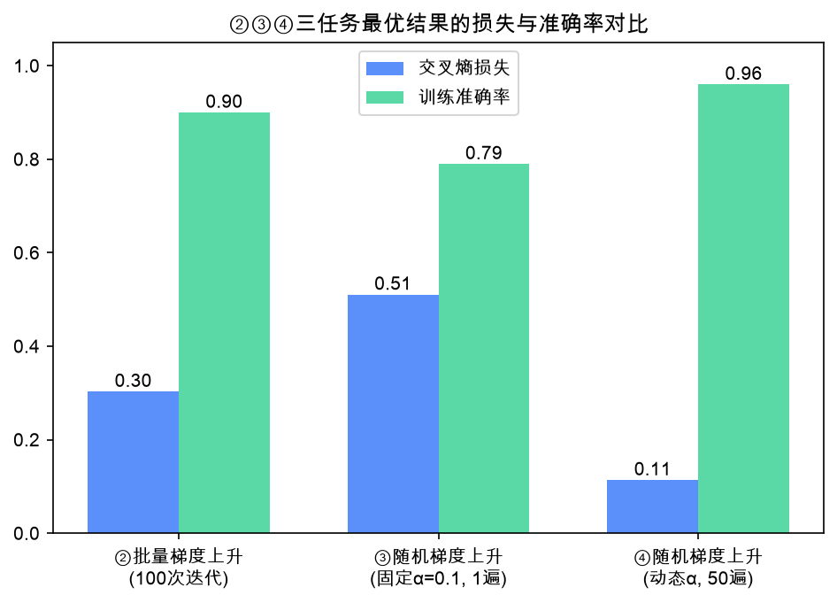

# 实验2 ②③④ 综合分析报告

> 代码：`exp2_iterations.py`（②）、`exp2_sga_lr.py`（③）、`exp2_sga_dynamic_lr.py`（④）

## 一、三个任务做了什么

| 任务 | 改变的参数 | 结论 |
|---|---|---|
| ② 简单（批量）梯度上升 | 迭代次数 5 / 50 / 100 | 次数越多损失越低，但"先快后慢" |
| ③ 简单随机梯度上升 | 固定学习率 0.001 / 0.01 / 0.1 | α 小了走不动（42%），α 大了震荡（79%） |
| ④ 随机梯度上升 + 动态学习率 | 3 种衰减调度，50 遍 | 全部收敛到 96%+，效果最好 |

## 二、结果对比

| 任务 | 最优设置 | 交叉熵损失 | 训练准确率 |
|---|---|---|---|
| ② | 100 次迭代 | 0.303 | 90% |
| ③ | α=0.1，只走 1 遍 | 0.511 | 79% |
| ④ | 反比衰减 α=4/(1+j+i)+1e-4 | **0.114** | 96% |

各任务分隔线图：②`exp2_iterations_compare.png`、③`exp2_sga_lr_compare.png`、④`exp2_sga_dynamic_lr.png`。

## 三、分析

1. **②迭代次数**：损失 0.495→0.356→0.303 单调下降，分隔线逐步转正；但 5→50 的改善远大于 50→100，梯度法先快后慢，超过收敛所需轮数后收益递减。
2. **③固定学习率的两难**：α=0.001 时只走一遍基本没学起来（准确率 42%）；α=0.1 走得最远、准确率最高（79%），但损失反而略高于 α=0.01——大步长 + 随机性导致权重在最优点附近震荡。
3. **④动态学习率解开两难**：前期大步长快走、后期小步长细调，三种调度都收敛到 96%+ 准确率；衰减太快的指数调度（0.9^j）略差，说明衰减速度要与总轮数匹配。

## 四、总体结论

- 同为 100 次更新，随机法（③，0.511 / 79%）不如批量法（②，0.303 / 90%）——单样本梯度噪声大；注意损失差距比准确率差距更大：两者错分的都是同几个边界样本，但批量法对错分样本的置信度更高；
- 从③到④只改"固定 α → 动态 α + 多轮"，损失 0.511→0.114、准确率 79%→96%，**提升最大**；
- ④甚至反超批量法——随机扰动+小开销正是 SGD 成为深度学习标准优化器的原因；
- 一条调参逻辑链：**迭代次数（②）决定学多久 → 学习率（③）决定每步多大 → 动态调度（④）把两者统一成"先快后稳"**，学习率调度是其中最本质的超参数。