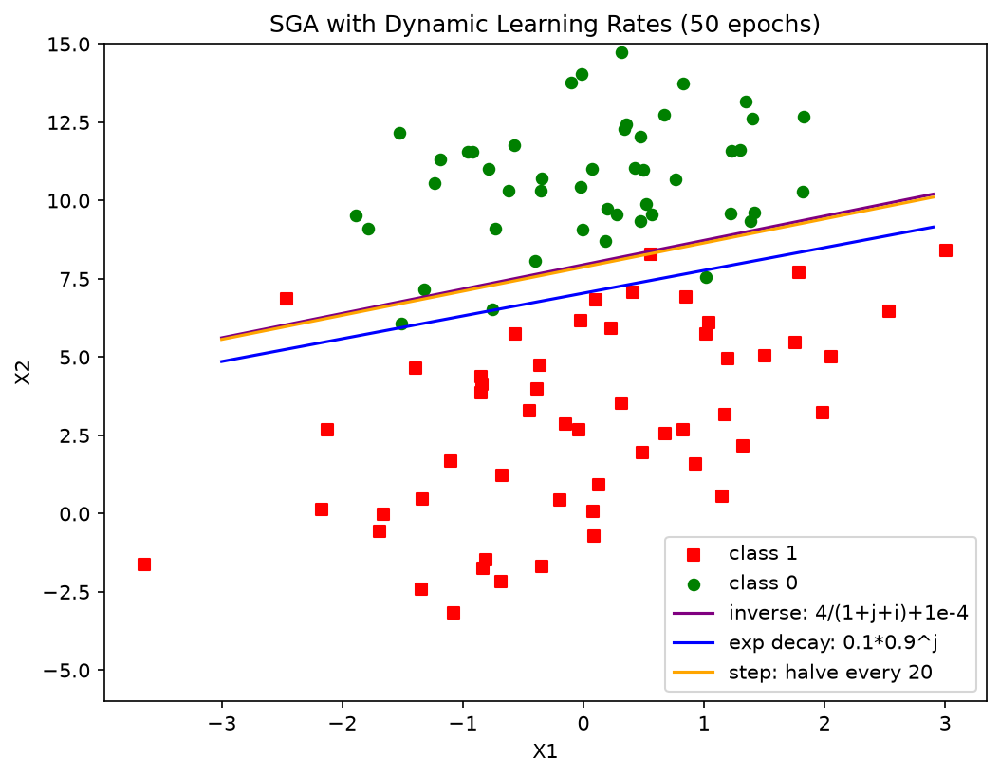

# 实验2 逻辑回归 —— ④ 动态学习率的随机梯度上升对比报告

> 代码：`exp2_sga_dynamic_lr.py`；数据：`exp2_SampleData.txt`；图：`exp2_sga_dynamic_lr.png`
> 方法：随机梯度上升（每轮随机打乱样本顺序、逐样本更新），遍历数据集 **50 遍**（numIter=50），对比 3 种动态学习率调度。

## 一、为什么需要动态学习率

实验③表明：固定学习率的简单随机梯度上升面临两难——**大了后期震荡**（权重在最优点附近跳动，全量损失不保证最优），**小了前期学不动**。动态学习率的思路是"分阶段"：

> **前期用大步长快速接近最优点，后期用小步长精细收敛**——即学习率随时间衰减。

本实验实现 3 种典型衰减调度（均满足"至少 2 种动态学习率"的要求）：

| 方法 | 公式 | 特点 |
|---|---|---|
| ① 反比衰减（教材法） | $\alpha = \dfrac{4}{1+j+i} + 0.0001$ | 随全局更新次数 j+i 反比衰减，保证 α 永远 > 0.0001，不会减到 0 |
| ② 指数衰减 | $\alpha = 0.1 \times 0.9^{\,j}$ | 每个遍历轮次 j 衰减一次，衰减平滑、快 |
| ③ 阶梯衰减 | $\alpha = 0.1 \times 0.5^{\lfloor j/20 \rfloor}$ | 每 20 轮减半，前 20 轮保持大步长 |

（j 为遍历轮次，i 为轮内样本序号，m=100。方法①即教材 `stocGradAscent1` 的调度。）

## 二、实验设置

- 权重初始化全 1；每轮 `shuffle` 后逐样本更新；固定随机种子保证可复现；
- 遍历 50 遍 = 5000 次单样本更新（与实验③"只走一遍"形成对照）；
- 评价指标：全量交叉熵损失、训练准确率、分隔线位置。

## 三、实验结果

| 调度方法 | 权重 w = (w0, w1, w2) | 交叉熵损失 | 训练准确率 |
|---|---|---|---|
| ① 反比衰减 4/(1+j+i)+1e-4 | (13.09, 1.28, −1.65) | **0.1139** | 96% |
| ② 指数衰减 0.1·0.9^j | (6.11, 0.63, −0.87) | 0.1376 | **97%** |
| ③ 阶梯衰减 每20轮减半 | (10.36, 1.01, −1.32) | 0.1159 | 96% |

图中：红方块=类别1，绿圆点=类别0；紫线=反比衰减，蓝线=指数衰减，橙线=阶梯衰减。

## 四、结果分析

1. **三种动态调度全部收敛**：交叉熵损失降到 0.11~0.14、准确率 96%~97%，分隔线（紫/橙几乎重合，蓝略低一点）都正确地分开了两类。对比实验③（固定 α、只走一遍，最好也就损失 0.51、准确率 79%），**"动态学习率 + 多轮迭代"带来了质的提升**。
2. **三种方法的差异**：
   - 反比衰减与阶梯衰减结果几乎一致（损失 0.114 vs 0.116）：两者的共同点是**前期 α 很大**（反比法首步 α≈4，阶梯法前 20 轮 α=0.1）且**后期保底**（反比法保底 1e-4，阶梯法最后 α=0.1/2²≈0.0125），都能"先猛走、后细调"；
   - 指数衰减（0.9^j）衰减太快，30 轮后 α 已小于 0.005，后期接近固定小步长，优化"提前减速"，最终损失（0.138）略差，但准确率反而最高（97%）——说明训练准确率与全量损失在错分样本上并不完全同步；
3. **权重幅值的观察**：三种方法的 w0（截距）都显著增大（6~13），分隔线整体上移、离两类样本的间隔带更远——损失继续下降时，边界位置变化不大，主要在**拉开两类样本的预测置信度**，与实验②后期的现象一致；
4. **反比衰减的保底项 0.0001 的作用**：若无保底项，α 随 j+i 增大会趋于 0，后期等于停止学习；保底项保证始终有微小的更新能力，这是教材调度设计的巧妙之处；
5. **与批量法对比**：批量梯度上升（实验②，100 次全量迭代）损失 0.303，而动态随机法 50 遍后损失 0.114 **优于批量法**——随机性反而帮助跳出了平缓方向的缓慢爬行（类似 SGD 的隐式正则/扰动效应），且单次更新开销小得多。

## 五、结论与收获

1. 动态学习率的核心价值：**解开了"前期要快"与"后期要稳"的矛盾**——三种衰减调度都显著优于固定学习率；
2. 衰减速度本身是超参数：衰减太快（如 0.9^j 配 50 轮）会"未到最优先减速"，衰减太慢则后期仍有震荡，需要与总迭代轮数匹配；
3. 掌握了三种经典调度（反比/指数/阶梯）的实现，它们正是现代深度学习中 lr_scheduler（StepLR、ExponentialLR、poly schedule）的雏形。