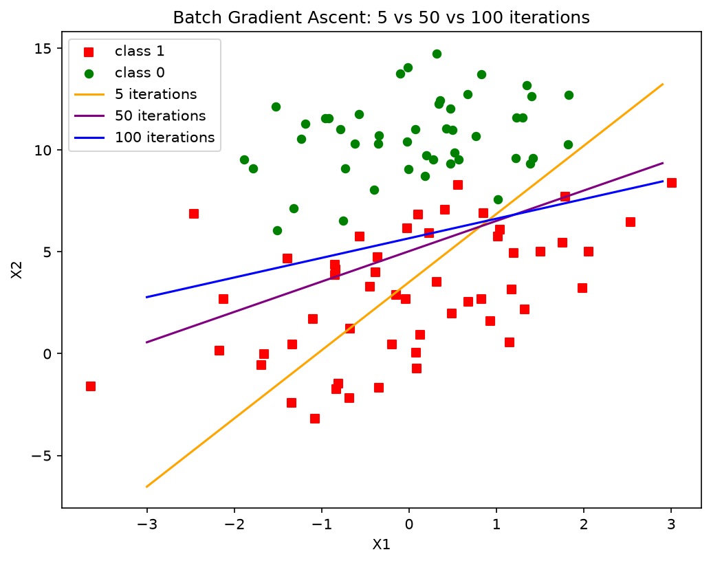

# 实验2 逻辑回归 —— ② 简单梯度上升迭代 5 / 50 / 100 次结果对比报告

> 代码：`exp2_iterations.py`；数据：`exp2_SampleData.txt`（100 个二维样本，两类各约 50 个）；图：`exp2_iterations_compare.png`
> 方法：**简单（批量）梯度上升**，学习率 alpha=0.001，权重初始化为全 1，分别迭代 5、50、100 次。

## 一、实验原理

逻辑回归用 sigmoid 函数把线性输出映射为概率：$h_\theta(x)=\sigma(x^\theta)=\dfrac{1}{1+e^{-x^\theta}}$。最大化对数似然等价于**梯度上升**更新：

$$\theta \leftarrow \theta + \alpha \cdot X^\top(Y - h)$$

其中 $Y-h$ 即"预测为正类的概率不足/超出真实标签"的误差向量。分隔线为 $w_0 + w_1 x_1 + w_2 x_2 = 0$（sigmoid=0.5 的等概率线）。

## 二、实验设置

- 数据：`exp2_SampleData.txt`，每行 `x1 x2 label`；
- 训练：批量梯度上升（每轮用全部 100 个样本计算梯度），alpha=0.001，权重初值全 1；
- 对比维度：迭代次数 5 / 50 / 100，观察权重、交叉熵损失与分隔线位置的变化。

## 三、实验结果

| 迭代次数 | 权重 w = (w0, w1, w2) | 交叉熵损失 | 分隔线形态 |
|---|---|---|---|
| 5 | (0.954, 0.909, -0.271) | 0.4948 | 陡斜率（0.909），明显偏陡，左下-右上走向，分类面倾斜错误 |
| 50 | (1.572, 0.466, -0.312) | 0.3558 | 斜率降到 0.466，较好地分开两类 |
| 100 | (2.062, 0.351, -0.364) | 0.3030 | 斜率进一步降到 0.351，截距升高 |

图中：红方块=类别1，绿圆点=类别0；橙色线=5次，紫色线=50次，蓝色线=100次。

## 四、结果分析

1. **损失单调下降**：交叉熵损失 0.4948 → 0.3558 → 0.3030，说明梯度上升确实在逐步逼近最优权重；迭代次数越多，似然越大。
2. **分隔线随迭代不断"转正"**：5 次时线还很陡（橙色），把不少红方块划到了线的上方（错误一侧）；50 次时（紫色）已能大体分开两类；100 次时（蓝色）斜率继续变小、截距上移，两类间的间隔带（margin）更均衡。
3. **为什么 50→100 线的变化看起来不大但损失仍在明显下降**：逻辑回归的损失由全体样本的"预测概率与标签的差"共同决定，分隔线只反映 sigmoid=0.5 的等概率面。迭代后期权重主要在优化**离边界较远样本的置信度**（把错分样本的概率从"接近0.5"推向正确一侧），而不是大幅移动边界本身，因此线看起来变化放缓、损失下降却仍在继续。
4. **收敛速度偏慢的原因**：alpha=0.001 且每轮梯度规模有限，5 次迭代远不足以收敛；从 5→50 的变化幅度远大于 50→100，说明越接近最优点梯度越小、步长（alpha×梯度）越小，这是梯度法"先快后慢"的普遍规律。
5. **结论**：迭代次数是逻辑回归训练的重要超参数——太少欠拟合（分类面方向都不对），增加迭代持续降低训练损失；结合本实验，100 次仍未完全收敛，训练损失还会继续下降，可通过加大迭代轮数或提高 alpha 加速。

## 五、结论与收获

- 梯度上升与梯度下降只差一个正负号，本质相同：沿"似然的梯度"方向更新参数；
- 通过 5/50/100 次的对比直观看到**决策边界从错误方向逐步旋转到正确位置**的过程；
- 学会区分"分隔线位置"与"损失值"两个观察角度：后者更敏感、更能反映优化进度，这也是深度学习中始终以损失曲线而非仅凭可视化判断训练进度的原因。