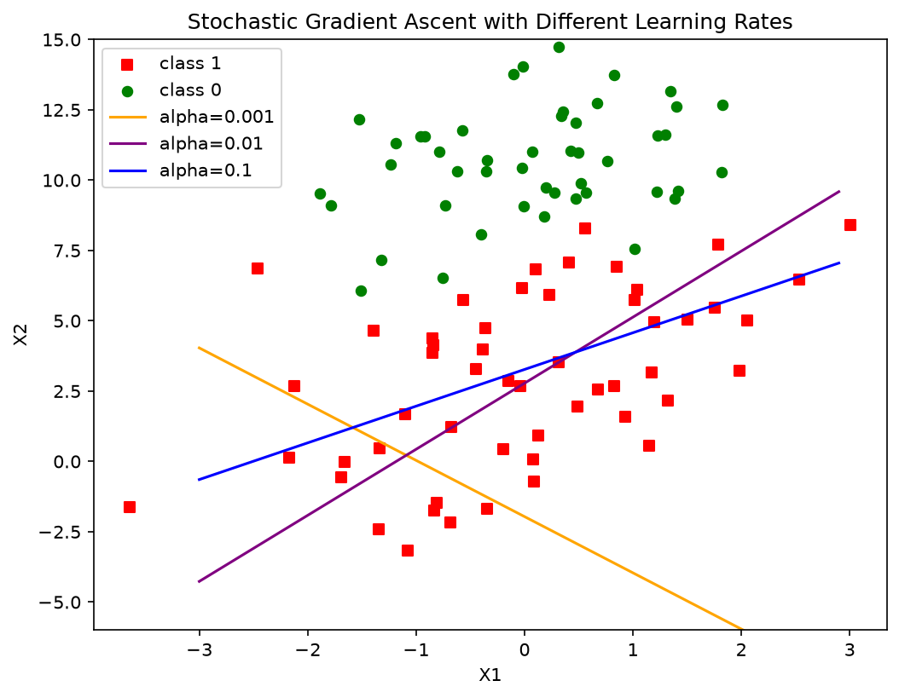

# 实验2 逻辑回归 —— ③ 3个不同学习率下的简单随机梯度上升对比报告

> 代码：`exp2_sga_lr.py`；数据：`exp2_SampleData.txt`；图：`exp2_sga_lr_compare.png`
> 方法：**简单随机梯度上升**（`stocGradAscent0`）：权重初始化为全 1，按样本顺序逐个计算梯度并立即更新，**只遍历数据集一遍**（100 次更新），学习率固定不变。

## 一、方法说明：随机 vs 批量梯度上升

| | 批量梯度上升（实验②） | 简单随机梯度上升（本实验） |
|---|---|---|
| 每次更新用的样本 | 全部 100 个 | 1 个 |
| 100 轮的更新次数 | 100 次 | 100 次（仅 1 遍） |
| 梯度噪声 | 无，路径平滑 | 有，逐样本方向波动大 |
| 单次更新开销 | 大 | 小 |

更新公式相同：$\theta \leftarrow \theta + \alpha\,(y_i-h_i)\,x_i$，只是梯度由单个样本估计。

## 二、实验设置

- 3 个学习率：$\alpha$ = 0.001、0.01、0.1；
- 其余完全相同：权重初值全 1、按数据集原始顺序遍历一遍、sigmoid 模型；
- 评价指标：最终权重、全量数据的交叉熵损失、训练准确率、分隔线位置。

## 三、实验结果

| 学习率 | 权重 w = (w0, w1, w2) | 交叉熵损失 | 训练准确率 | 分隔线形态 |
|---|---|---|---|---|
| 0.001 | (0.964, 0.983, **+0.492**) | 3.1536 | 42% | 斜率符号错误（w2 为正），线走向完全不对 |
| 0.01 | (1.017, 0.859, −0.366) | 0.5011 | 72% | 已有基本正确的走向，但离最优还远 |
| 0.1 | (2.386, 0.952, −0.730) | 0.5107 | 79% | 明显更陡，训练准确率最高 |

图中：红方块=类别1，绿圆点=类别0；橙线=α=0.001，紫线=α=0.01，蓝线=α=0.1。

## 四、结果分析

1. **α=0.001：步长过小，一遍数据"走不动"**。随机梯度上升只遍历一遍（100 次单样本更新），每次更新的有效步长约为 $\alpha x_i(y_i-h_i)$，量级只有 10⁻³。100 步之后权重几乎还停留在初始值附近——注意 w2 仍是**正的** 0.49（初始值 1 略降），分隔线斜率为正，与两类真实分布方向相反，准确率 42% 连随机猜（50%）都不如。这说明**小学习率 + 少迭代次数**是欠训练的典型组合。
2. **α=0.01：适中的步长，一遍数据即可学到大致正确的边界**。损失从初始的高位降到 0.50，分隔线方向正确但尚未贴合两类间隔带，说明仍欠收敛。
3. **α=0.1：步长最大，训练准确率最高（79%）**。单次更新移动距离是 α=0.01 的 10 倍，一遍下来权重离初始值更远、边界调整幅度更大。但交叉熵损失（0.5107）反而略高于 α=0.01（0.5011）——这正是**随机性的体现**：逐样本更新的方向来回跳动，大步长使权重在最优点附近震荡，最终停在哪里取决于最后一个样本的梯度，全量损失未必单调更优。
4. **与实验②（批量法 100 次迭代，损失 0.303）对比**：同样"100 次更新"，随机法的损失（≈0.50）明显差于批量法。原因：① 单样本梯度是全量梯度的无偏但高方差估计，有效信息量少；② 简单随机法没有衰减学习率、也没有多遍迭代（对比教材中的改进版 `stocGradAscent1`：alpha 随迭代衰减 + 随机抽取样本，效果即接近批量法）。
5. **结论**：随机梯度上升单次更新便宜、适合大数据集，但**对学习率更敏感**——太小则一遍数据学不起来，太大则结果震荡；实践中用"适当大的学习率 + 多轮迭代 + 学习率衰减"来兼顾速度与稳定性。

## 五、结论与收获

- 直观理解了**随机梯度上升中"迭代次数 × 学习率"共同决定总学习量**：本实验固定只走 100 步，学习率就成了决定性因素；
- 观察到随机法的两大特征：结果有**波动/不保证单调**（α=0.1 损失略高于 α=0.01 但准确率更高）、边界粗糙但快速可用；
- 理解了从 `stocGradAscent0`（固定 alpha、顺序遍历）到 `stocGradAscent1`（alpha 衰减、随机抽样）改进的动机，为后续随机优化（SGD/Adam 等）打下直觉基础。