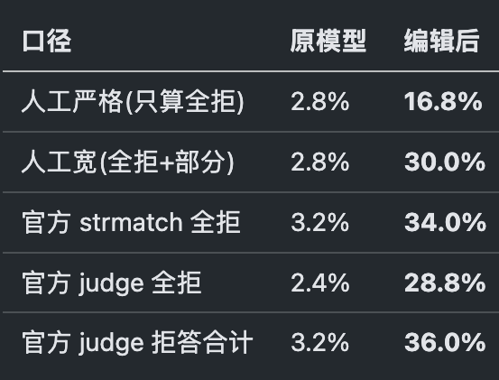
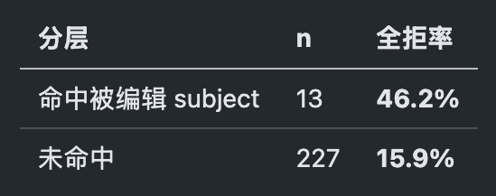
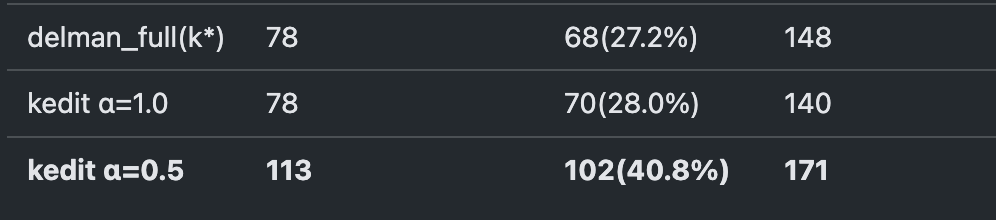

| 内容     |                                      |
| ------ | ------------------------------------ |
| 研究问题   | 安全编辑提升有害请求拒绝能力时，是否会让原本正常回答的良性请求也被拒绝？ |
| 已有观察   | 你在 DELMAN、Qwen2.5 和 XSTest 上的初步测试现象  |
| 当前不确定性 | 现象是否稳定？与编辑数量、编辑强度、请求语义邻近程度有什么关系？     |
| 下一步设想  | 在保留安全编辑效果的前提下，修复新增的良性拒绝              |
# XSTest实验结果

# 优化尝试 
## 中性平均-》语境相关
k_edit = k_H − α·(k_B − k*)

做了一些尝试但是都没有提升

# 相关的工作
[007-ToxEdit Adaptive Detoxification](../../模型编辑/007-ToxEdit%20Adaptive%20Detoxification.md)用中间隐藏状态上的线性 SVM 判断输入是否有害，再将其路由到原始或编辑后的 FFN 输出矩阵，在 SafeEdit 上同时提高拒答成功率和正常回答保持度

[ProSafePrune](../001-ProSafePrune-投影安全剪枝缓解过度拒绝.md)用三类指令的激活构建子空间，通过一次性减去选定层权重中的低秩成分，缓解无害请求的过度拒绝；实验显示误拒明显减少，但真正有害请求的拒绝率仍有小幅下降

目前看到的论文有相关的工作解决我们发现的问题

# 初步想法
DELMAN的方法对模型编辑+ ProSafePrune的方法进行误拒缓解

